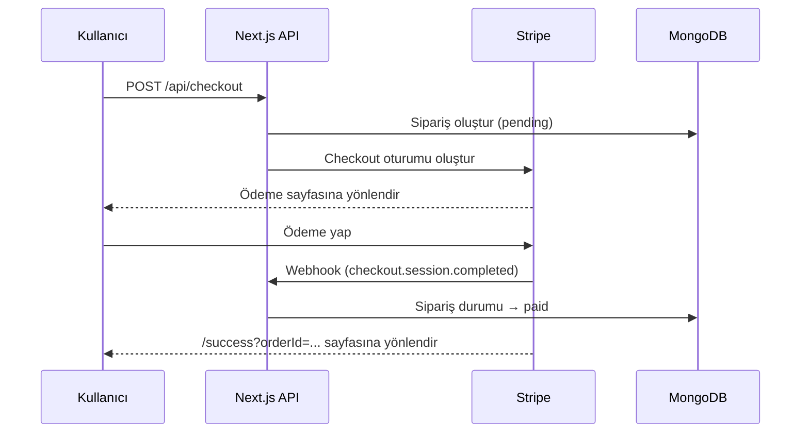

# 🚗 MORENT – Araç Kiralama Platformu

Next.js 16 (App Router), MongoDB ve Stripe ile geliştirilmiş full-stack araç kiralama uygulaması. Kullanıcılar araç filosunu filtreleyerek inceleyebilir, tarih ve lokasyon seçerek rezervasyon yapabilir, Stripe üzerinden güvenli ödeme gerçekleştirebilir ve geçmiş siparişlerini görüntüleyebilir.

## Ekran Görüntüsü


## ✨ Özellikler

- 🔐 **Kimlik Doğrulama** – E-posta/şifre ile kayıt & giriş, opsiyonel Google OAuth (NextAuth, JWT oturum)
- 🚘 **Araç Kataloğu** – Arama, kategori, koltuk sayısı, vites, yakıt türü ve fiyata göre filtreleme; sıralama ve sayfalama
- 📄 **Araç Detay Sayfası** – Galeri, teknik özellikler ve rezervasyon formu
- 📅 **Rezervasyon** – Alış/iade lokasyonu, tarih ve saat seçimi, otomatik gün ve tutar hesaplama
- 💳 **Stripe Ödeme** – Stripe Checkout entegrasyonu, webhook ile sipariş durumunun güncellenmesi
- 🧾 **Siparişlerim** – Kullanıcıya ait tüm siparişlerin durum bilgisiyle listelenmesi
- ✅ **Başarılı / İptal Sayfaları** – Ödeme sonrası sipariş özeti
- 🌱 **Seed Endpoint'i** – Örnek araç verileriyle veritabanını tek istekle doldurma

## 🛠️ Kullanılan Teknolojiler

| Alan             | Teknoloji                                                     |
| ---------------- | ------------------------------------------------------------- |
| Framework        | [Next.js 16](https://nextjs.org) (App Router, Route Handlers) |
| Arayüz           | React 19, Tailwind CSS 4, Lucide React, Material Symbols      |
| Veritabanı       | MongoDB + Mongoose                                            |
| Kimlik Doğrulama | NextAuth.js (Credentials & Google), bcryptjs                  |
| Ödeme            | Stripe Checkout & Webhooks                                    |
| Dil              | TypeScript                                                    |

## 📁 Proje Yapısı

```
src/
├── app/
│   ├── api/
│   │   ├── auth/            # NextAuth ve kayıt endpoint'leri
│   │   ├── cars/            # Araç listeleme ve detay
│   │   ├── checkout/        # Stripe ödeme oturumu oluşturma
│   │   ├── orders/          # Kullanıcı siparişleri ve sipariş detay/güncelleme
│   │   ├── seed/            # Örnek veri yükleme
│   │   └── webhook/         # Stripe webhook
│   ├── cars/                # Araç kataloğu ve detay sayfaları
│   ├── orders/              # Siparişlerim sayfası
│   ├── login/ register/     # Giriş ve kayıt sayfaları
│   ├── success/ cancel/     # Ödeme sonuç sayfaları
│   └── page.tsx             # Ana sayfa
├── components/              # Arayüz bileşenleri (cars, home, layout, providers)
├── lib/                     # DB bağlantısı, auth ayarları, yardımcı fonksiyonlar
└── models/                  # Mongoose modelleri (Car, User, Order)
```

## 🚀 Kurulum

### Gereksinimler

- Node.js 20+
- MongoDB (yerel kurulum veya [MongoDB Atlas](https://www.mongodb.com/atlas))
- [Stripe](https://stripe.com) hesabı (test modu yeterlidir)

### 1. Projeyi klonlayın

```bash
git clone https://github.com/<kullanici-adi>/car-rental.git
cd car-rental
```

### 2. Bağımlılıkları yükleyin

```bash
npm install
```

### 3. Ortam değişkenlerini ayarlayın

`.env.example` dosyasını `.env.local` olarak kopyalayın ve değerleri doldurun:

```bash
cp .env.example .env.local
```

| Değişken                     | Açıklama                                                              | Zorunlu |
| ---------------------------- | --------------------------------------------------------------------- | ------- |
| `MONGODB_URI`                | MongoDB bağlantı adresi                                               | ✅      |
| `NEXTAUTH_SECRET`            | JWT imzalama anahtarı (`openssl rand -base64 32` ile üretebilirsiniz) | ✅      |
| `NEXTAUTH_URL`               | Uygulamanın adresi (örn. `http://localhost:3000`)                     | ✅      |
| `NEXT_PUBLIC_APP_URL`        | Stripe yönlendirmeleri için uygulama adresi                           | ✅      |
| `STRIPE_SECRET_KEY`          | Stripe gizli anahtarı (`sk_test_...`)                                 | ✅      |
| `GOOGLE_CLIENT_ID`           | Google OAuth istemci ID'si                                            | ❌      |
| `GOOGLE_CLIENT_SECRET`       | Google OAuth istemci anahtarı                                         | ❌      |
| `NEXT_PUBLIC_IMAGIN_API_KEY` | Araç görselleri için Imagin Studio API anahtarı                       | ❌      |

> Google değişkenleri tanımlanmazsa Google ile giriş seçeneği otomatik olarak devre dışı kalır.

### 4. Geliştirme sunucusunu başlatın

```bash
npm run dev
```

Uygulama [http://localhost:3000](http://localhost:3000) adresinde çalışacaktır.

### 5. Örnek verileri yükleyin

Veritabanını örnek araçlarla doldurmak için şu adrese bir istek atın:

```bash
curl -X POST http://localhost:3000/api/seed
```

> ⚠️ Bu işlem mevcut tüm araç kayıtlarını silip yeniden oluşturur.

### 6. Stripe webhook'unu yerelde dinleyin

Ödeme sonrası sipariş durumunun güncellenmesi için [Stripe CLI](https://docs.stripe.com/stripe-cli) ile webhook olaylarını yerel sunucuya yönlendirin:

```bash
stripe login
stripe listen --forward-to localhost:3000/api/webhook
```

Test ödemelerinde `4242 4242 4242 4242` kart numarasını, ileri bir tarihi ve herhangi bir CVC kodunu kullanabilirsiniz.

## 📡 API Endpoint'leri

| Metot          | Endpoint                  | Açıklama                                                      | Yetki     |
| -------------- | ------------------------- | ------------------------------------------------------------- | --------- |
| `POST`         | `/api/auth/register`      | Yeni kullanıcı kaydı                                          | –         |
| `*`            | `/api/auth/[...nextauth]` | NextAuth giriş/çıkış işlemleri                                | –         |
| `GET`          | `/api/cars`               | Araçları filtreleme, sıralama ve sayfalama ile listeler       | –         |
| `GET`          | `/api/cars/:id`           | Araç detayını getirir                                         | –         |
| `POST`         | `/api/checkout`           | Sipariş oluşturur ve Stripe ödeme oturumu başlatır            | 🔒 Oturum |
| `GET`          | `/api/orders`             | Giriş yapmış kullanıcının siparişlerini listeler              | 🔒 Oturum |
| `GET`          | `/api/orders/:id`         | Sipariş detayını getirir (ödeme durumunu Stripe ile doğrular) | –         |
| `PATCH`        | `/api/orders/:id`         | Sipariş durumunu günceller                                    | –         |
| `POST`         | `/api/webhook`            | Stripe ödeme olaylarını işler                                 | Stripe    |
| `GET` / `POST` | `/api/seed`               | Örnek araç verilerini yükler                                  | –         |

### `/api/cars` sorgu parametreleri

| Parametre       | Örnek                                          | Açıklama              |
| --------------- | ---------------------------------------------- | --------------------- |
| `page`, `limit` | `page=1&limit=8`                               | Sayfalama             |
| `search`        | `search=bmw`                                   | Marka/model araması   |
| `category`      | `category=Sport,SUV`                           | Kategori filtresi     |
| `capacity`      | `capacity=2,4`                                 | Koltuk sayısı         |
| `transmission`  | `transmission=Otomatik`                        | Vites türü            |
| `fuelType`      | `fuelType=Elektrik`                            | Yakıt türü            |
| `maxPrice`      | `maxPrice=5000`                                | Maksimum günlük fiyat |
| `sortBy`        | `popular`, `price_asc`, `price_desc`, `newest` | Sıralama              |

Tüm endpoint'leri denemek için projedeki [`morent_postman_collection.json`](./morent_postman_collection.json) dosyasını Postman'e içe aktarabilirsiniz.

## 🔄 Ödeme Akışı



Sipariş durumları: `pending` (ödeme bekleniyor) · `paid` (ödendi) · `completed` (tamamlandı) · `cancelled` (iptal / süresi doldu)

## 📜 Komutlar

| Komut           | Açıklama                       |
| --------------- | ------------------------------ |
| `npm run dev`   | Geliştirme sunucusunu başlatır |
| `npm run build` | Production derlemesi oluşturur |
| `npm run start` | Production sunucusunu başlatır |
| `npm run lint`  | ESLint kontrolü yapar          |

## 📄 Lisans

Bu proje eğitim amaçlı geliştirilmiştir.
